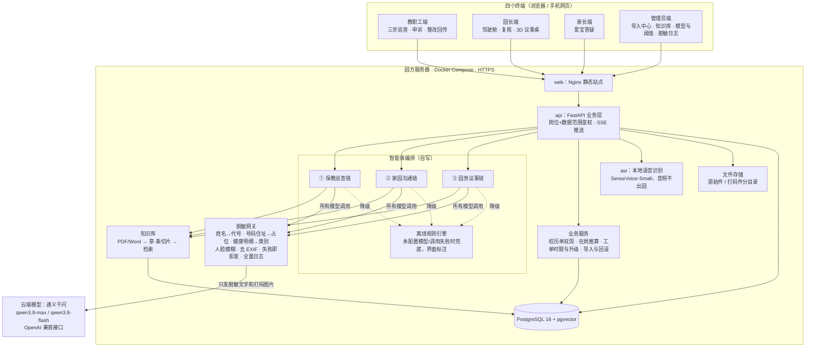
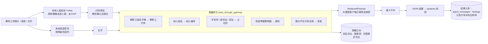
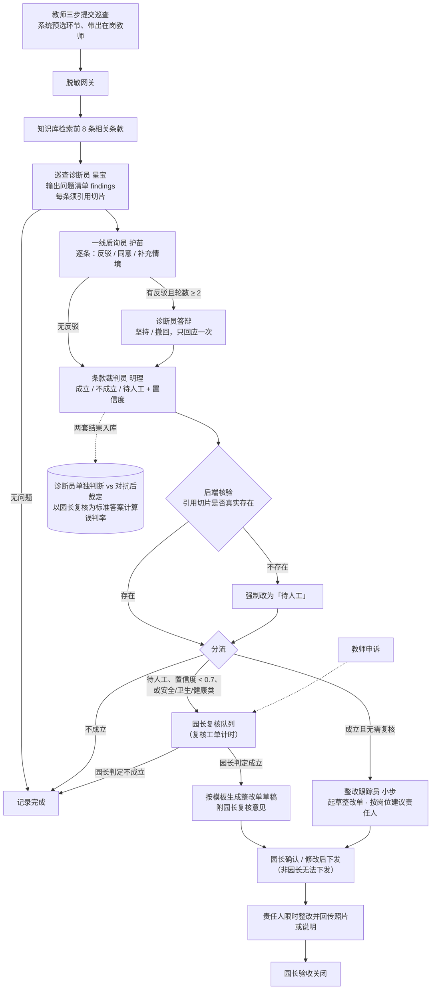
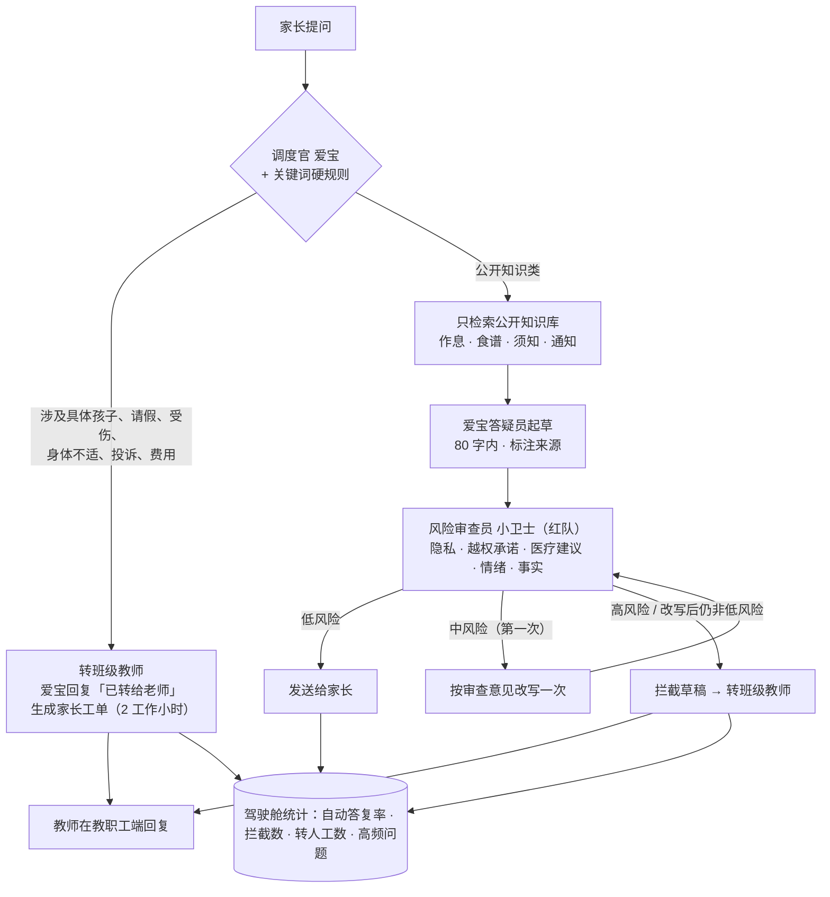
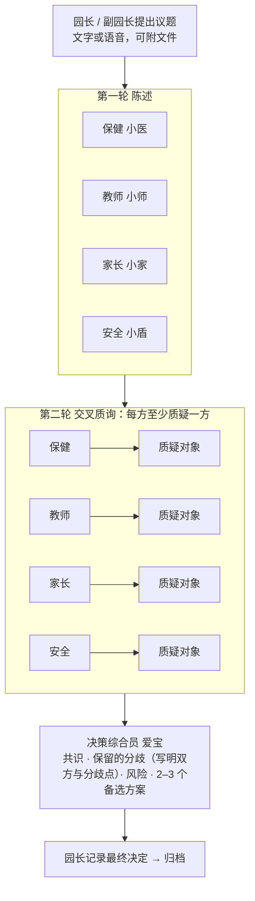
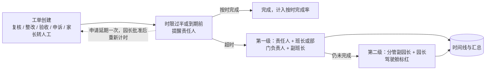
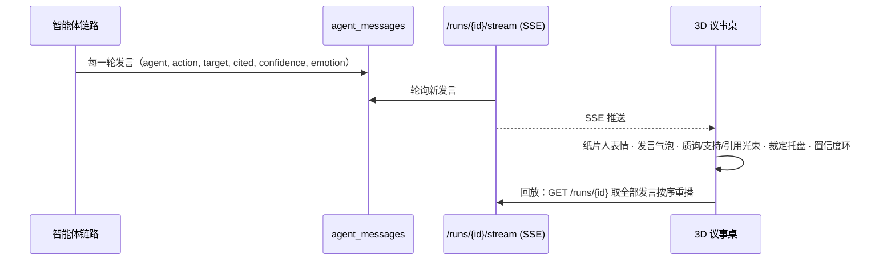

# 爱宝园务大脑 · 系统架构图与工作流图

> 图用 Mermaid 编写，可在支持 Mermaid 的 Markdown 编辑器中查看；用浏览器打开同目录的 `03_系统架构与工作流图.html` 可直接渲染，截图或"打印为 PDF"后放入参赛材料。
> 图中内容均与 `api/app/agents/*.py`、`api/app/gateway/` 的实际实现一致。

## 图 1 系统总体架构

## 图 2 数据流与脱敏网关

## 图 3 ① 保教巡查链工作流

## 图 4 ② 家园沟通链工作流

## 图 5 ③ 园务议事链工作流

## 图 6 工单时限与两级升级

计时只算校历内工作日 7:30–18:00，跳过周末、夜间和校历外假期；升级只发提醒，不改变责任人，不自动追责。

## 图 7 3D 议事桌数据驱动

